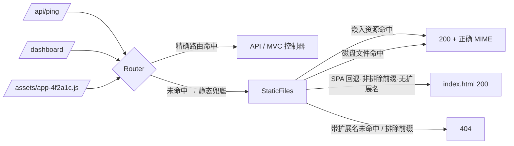

# Vue/SPA 单 exe 打包与运行（对齐 DH.RustBase）

> 目标：和 DH.RustBase 的 `Doc/SPA与MVC一体化.md` 同一套口径 —— 前端构建产物**编译期嵌入**后端可执行文件，
> 生产环境**单进程、单端口、无 Node 运行环境、无 nginx**；开发期用 Vite dev server 热更新 + API 代理。

相关实现：

| 能力 | 位置 |
|---|---|
| 资源表生成器（≈ DH.RustBase 的 `build.rs`） | `src/build/spa_gen.zig` → 构建出 `zzig-spa-gen` |
| 批量嵌入 | `StaticFiles.embed` / `embedMany` / **`embedAssets`**（新增） |
| SPA 深链接回退 + 排除前缀 | `App.init(.{ .spa_fallback = true, .spa_excludes = &.{"/api"} })` |
| 可运行示例 | `examples/spa_demo.zig` + `examples/spa/web/dist/`（`zig build spa-demo`） |

---

## 1. 与 ASP.NET Core / DH.RustBase 的对照

| ASP.NET Core | DH.RustBase | zzig |
|---|---|---|
| `app.UseStaticFiles()` | `StaticFiles::new("wwwroot")` | `App.init(.{ .wwwroot = "wwwroot" })` |
| `ManifestEmbeddedFileProvider` / 单文件发布 | `embed_many(SPA_FILES)` | `statics.embedAssets(&spa_assets.files)` |
| `ContentTypeProvider`（按扩展名给 MIME） | `embed_many` 内推断 | 同一张 MIME 表（`static_files.mimeType`） |
| `ServeUnknownFileTypes = false` | 同名开关 | 同名开关（未知扩展名默认 404） |
| `endpoints.MapFallbackToFile("index.html")` | `.spa_fallback(true)` | `.spa_fallback = true` |
| `MapFallbackToFile` + 排除 `/api` | `.spa_excludes(&["/api"])` | `.spa_excludes = &.{"/api"}` |
| 资源表生成 | **`build.rs`** 扫描 dist | **`zzig-spa-gen`**（build artifact）扫描 dist |

**为什么 Zig 不用 `build.rs` 那种"复制一段脚本"的方式**：Zig 的 build 脚本之间不能互相 `@import`，
但**可以依赖别的包的 artifact**。所以扫描逻辑做成程序，消费方三行就能接上，避免每个项目复制 60 行扫描代码。

## 2. 三步接入

### ① `build.zig.zon` 加依赖

```zig
.dependencies = .{
    .zzig = .{ .path = "../zzig" }, // 或 git url + hash
},
```

### ② `build.zig` 生成资源表并注册为匿名模块

```zig
const zzig_dep = b.dependency("zzig", .{ .target = target, .optimize = optimize });

// 用 zzig 提供的生成器扫描前端 dist
const gen = b.addRunArtifact(zzig_dep.artifact("zzig-spa-gen"));
gen.addArg("--dist");
gen.addArg("web/dist");                 // ← 前端构建输出目录（相对项目根）
gen.addArg("--out");
const spa_assets = gen.addOutputFileArg("spa_assets.zig");

// 把生成的表作为匿名模块 `spa_assets` 注入你的程序
exe_mod.addAnonymousImport("spa_assets", .{ .root_source_file = spa_assets });
exe_mod.addImport("zzig", zzig_dep.module("zzig"));
```

### ③ 程序里嵌入并开启 SPA 回退

```zig
const spa_assets = @import("spa_assets");

var app = try zzig.web.App.init(allocator, io, .{
    .wwwroot = "wwwroot",                 // 开发期目录（可以不存在；嵌入资源优先命中）
    .views_root = "Views",
    .spa_fallback = true,                 // 深链接回退 index.html
    .spa_excludes = &.{ "/api" },         // 后端命名空间保持 JSON 404
});
defer app.deinit();

try app.statics.embedAssets(&spa_assets.files); // ← 编译期嵌入整个 dist
try app.run("0.0.0.0", 8080, .{});
```

## 3. 请求管线（一个端口内的优先级）



实测（`zig build spa-demo`，3 个嵌入资源，**wwwroot 故意指向不存在的目录**）：

| 请求 | 结果 |
|---|---|
| `GET /` | 200 `text/html`，365 字节（嵌入的 index.html） |
| `GET /dashboard` | 200 `text/html`，365 字节（SPA 回退） |
| `GET /user/42` | 200 `text/html`，365 字节（多级深链回退） |
| `GET /assets/index-4f2a1c.js` | 200 `text/javascript`，34 字节 |
| `GET /assets/index-9b3d7e.css` | 200 `text/css`，28 字节 |
| `GET /api/ping` | 200 `application/json` |
| `GET /api/unknown` | **404**（`/api` 排除，不回退） |
| `GET /assets/missing.js` | **404**（带扩展名，不回退） |

## 4. 开发 / 生产工作流

**开发（两进程，热更新最快）**

```ts
// vite.config.ts
server: {
  proxy: { '/api': { target: 'http://127.0.0.1:8080', changeOrigin: true } }
}
```

- 前端：`npm run dev`（Vite，例如 5173）
- 后端：`zig build run` —— 静态资源处于**目录模式**（`wwwroot/` 为空也不影响）
- 需要联调"真实产物"时：把 `dist` 输出到 `wwwroot/`，无需重编 Zig

**生产（单 exe）**

```bash
npm run build        # 产出 web/dist（哈希文件名、互相引用）
zig build -Doptimize=ReleaseFast
```

- 单进程/单端口：API、MVC 页面、SPA 共用；
- 无 CORS、无 nginx 必需、无 Node 运行环境；
- 交叉编译不受影响（嵌入内容是平台无关字节）。

## 5. 实现要点与坑

1. **`@embedFile` 不能跨包路径** —— 最初生成器写绝对路径（单独 `zig run` 能过），
   在模块体系下报 `embed of file outside package path`。
   正解：生成器把 dist 内容**复制到生成文件同目录**，表里用相对路径（生成文件与资源同属一个模块根）。
2. **前端未构建不阻断后端编译**：dist 不存在时生成**空表**并打印警告
   （对齐 DH.RustBase 的 `cargo:warning`），后端仍可单独编译运行。
3. **每次 `zig build` 都会重新扫描 dist**（build 脚本本身执行），生成内容变化 → 缓存失效 → 自动重编，
   等价于 `build.rs` 的 `rerun-if-changed`。
4. **MIME 由扩展名推断**（与磁盘下发同一张表）；`.js` → `text/javascript; charset=utf-8`。
5. **嵌入资源不受「未知扩展名默认拒绝」限制**：能进表说明开发者已明确提供。

## 6. 未做

- 压缩产物（`gzip`/`brotli` 预压缩文件优先下发）；
- 资源清单（`manifest.json`）解析与长缓存头（`immutable`）；
- `Service Worker` / PWA 相关约定。

## 7. 传输压缩（预压缩优先，零运行时 CPU）

口径与 DH.RustBase 不同，有意为之：

| | DH.RustBase | zzig |
|---|---|---|
| 动态响应 gzip | ✅ 响应级（默认开，≥256 字节，类型白名单，加 `Vary`） | ❌ 未做 |
| 静态文件 | ❌ **明确不压**（`resp.file.is_some()` 直接返回，怕整读把省下的内存吐回去） | ✅ **预压缩 `.gz` 优先**（流式发送，不整读、不耗 CPU） |

为什么 zzig 选预压缩：静态资源本来就全流式发送，运行时压缩必须整读（等于放弃流式的内存优势）；
而 Vite 产物适合构建期压一次、运行时原样下发。

**启用方式（磁盘根）**：把 `.gz` 和原文件放同一目录即可，服务端按 `Accept-Encoding` 协商自动优先下发：

```bash
# 构建期批量生成（任选）
npx vite-plugin-compression        # 或在 vite.config.ts 里配置
# 或
for f in dist/**/*.{js,css,svg,json}; do gzip -9 -k "$f"; done
```

请求带 `Accept-Encoding: gzip` → 下发 `app.js.gz`，并带：

```
content-encoding: gzip
vary: accept-encoding
content-type: text/javascript; charset=utf-8   # 按原始扩展名推断，不是 .gz
```

不带 gzip、或同名 `.gz` 不存在 → 自动回退原文件（不加任何编码头）。

**未做（重要）**：`embedAssets`（编译期嵌入，单 exe 形态）**暂不支持 `.gz` 变体** —— 生产单 exe 部署时
静态资源仍是未压缩下发。要补需要 `spa_gen` 在构建期生成 `.gz` 并让 `Embedded` 带 gzip 变体，见决策记录。